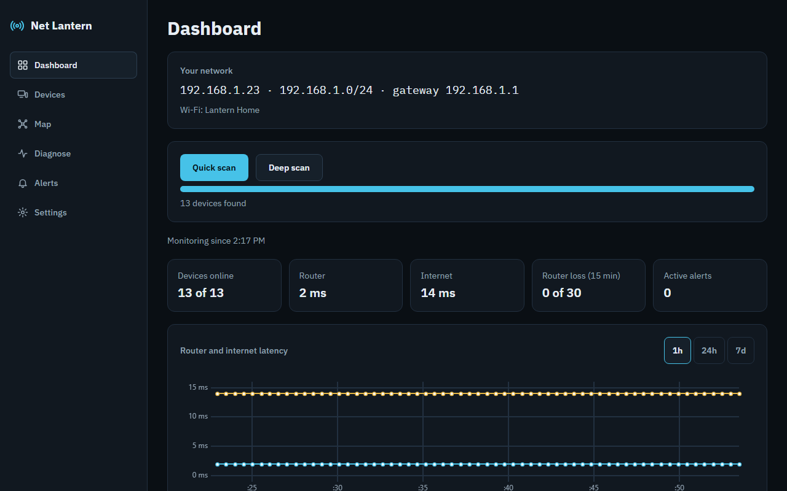
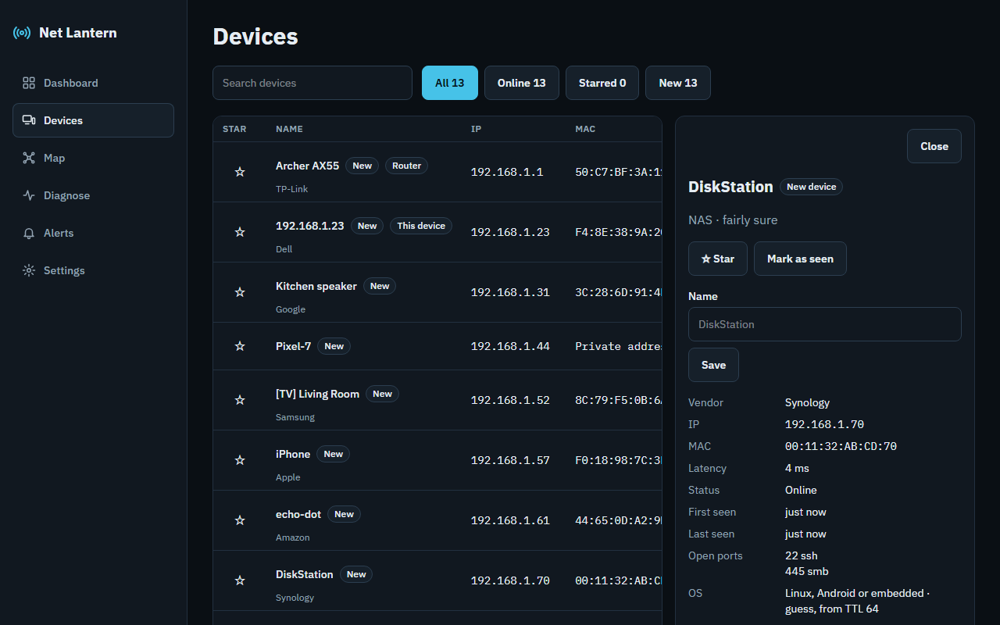
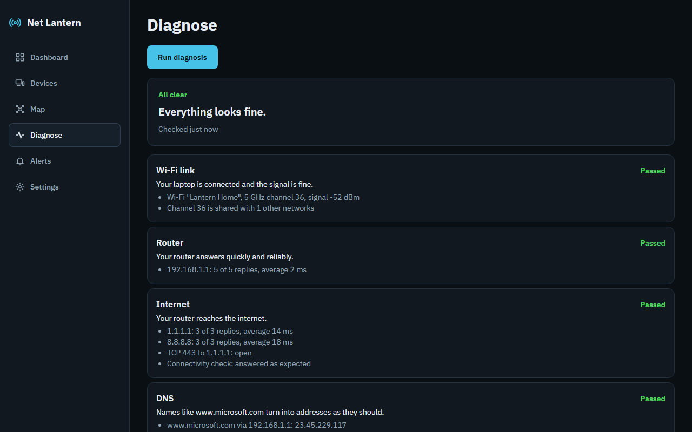
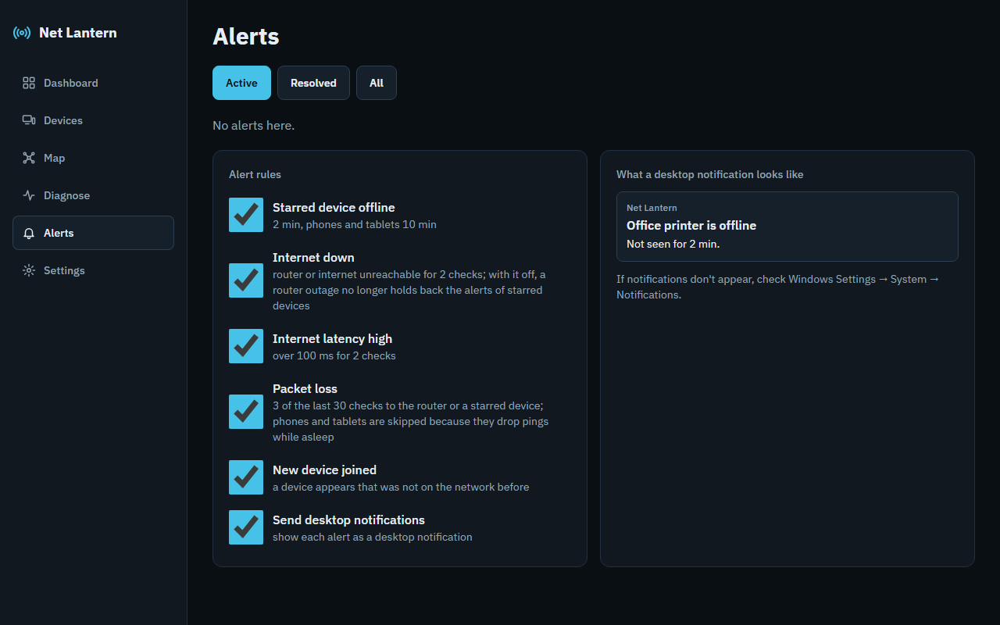
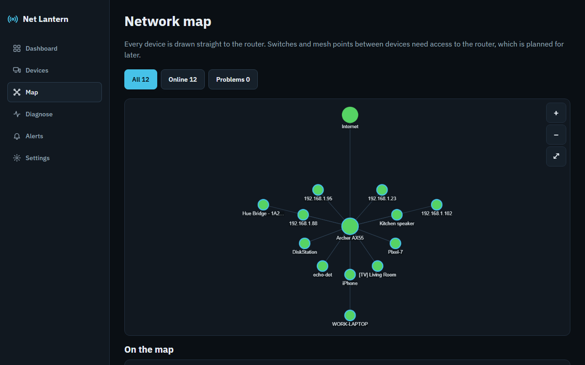
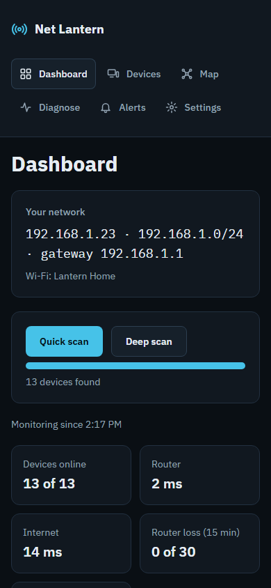
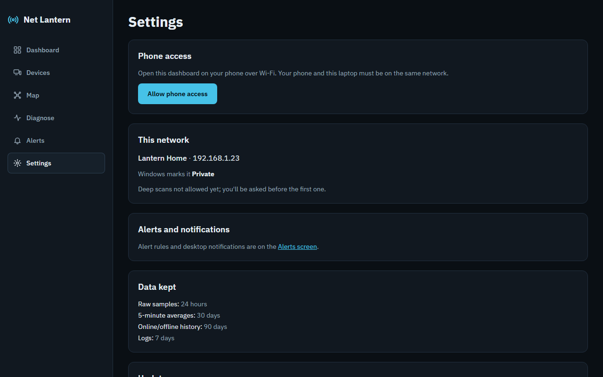

# Net Lantern

Net Lantern shows what's on your Wi-Fi and, when the internet breaks, which layer broke and what to try, all on your own laptop with no account and nothing uploaded.

Version 0.1.0. Windows 11.



## Download and install

Get the latest `NetLantern-<version>-setup.exe` from the [latest release](https://github.com/VighneshHM/net-lantern/releases/latest) and run it. It installs just for you, so no administrator rights are needed. Windows 11 only.

> Net Lantern isn't code-signed yet, so Windows SmartScreen may say "Windows protected your PC" the first time you run the installer. Check the file against SHA256SUMS.txt (below), then click **More info** and **Run anyway**.

To check the download, run this in PowerShell and compare the hash with the matching line in `SHA256SUMS.txt` from the same release:

```powershell
Get-FileHash .\NetLantern-<version>-setup.exe -Algorithm SHA256
```

The release also has `netlantern-<version>-x64.exe`, the standalone program without the tray or installer. See [Build from source](#build-from-source) for its flags.

## What it does

**Scan.** A quick scan finds the devices on your network in seconds and shows each one's address, maker, type and open services. Give devices your own names and star the ones you care about. A deep scan, which you opt into per network, also reads open ports and banners.



**Diagnose.** When something is wrong, Diagnose checks your Wi-Fi link, router, internet and DNS in turn, says which layer broke and what to try.



**Wi-Fi quality.** The Diagnose screen also shows your signal strength, the networks nearby and which channels are crowded. Windows hides this from apps without location permission; see [Wi-Fi details](#wi-fi-details-and-location-permission).

**Monitoring and alerts.** While Net Lantern runs it watches your router and internet over time, keeps a latency graph, and raises alerts when a new device joins, a starred device goes offline or the connection degrades. Alerts can appear as Windows notifications.



**Map and phone access.** The map draws your devices on a map around your router. You can open the dashboard from your phone on the same Wi-Fi.





Settings holds phone access, the update check, start at login, debug info and data deletion.



## Privacy and what Net Lantern sends

Net Lantern has no account and no telemetry. Scan data, device names and everything else stay on your computer. These are the only things it sends, and when.

### What a scan sends

ICMP pings and ARP requests to each address in the subnet, TCP connects to ports 80, 443, 445, 22 and 62078 on every device found present (whether it answered a ping or only ARP), mDNS and SSDP queries to their multicast groups, an mDNS query to each found device, an HTTP GET of the UPnP description a device advertises (sent only to that device's own address), NetBIOS name queries to found devices, and reverse DNS lookups to your router. Everything stays on your LAN; nothing goes to the internet.

### Deep scan

A deep scan is opt-in. The first time you click **Deep scan** on a network, Net Lantern asks whether it is a network you own or have permission to scan, and remembers the answer for that network. It then sends TCP connects to 100 common ports on every device found present (at most 8 at a time per device), reads the greeting of text services such as SSH and FTP, fetches the page title of web servers on private LAN addresses (self-signed certificates are accepted), and shows each device's open ports, banners and an OS guess. `netlantern --scan-once --deep` runs one from the command line; passing `--deep` is your permission. Everything stays on your local network, nothing leaves the LAN, and no admin rights are needed.

### What a diagnosis sends

Only when you run a diagnosis (the button, `POST /api/diagnose` or `--diagnose-once`), and never on a schedule, Net Lantern contacts:

- ICMP echo to `1.1.1.1` and `8.8.8.8`;
- a TCP connect to `1.1.1.1:443`, closed straight away;
- a plain-HTTP GET of `http://www.msftconnecttest.com/connecttest.txt` (redirects not followed), which detects sign-in pages on public Wi-Fi;
- DNS A queries for `www.microsoft.com` and `www.cloudflare.com`, sent to your system DNS servers and to `1.1.1.1`;
- an HTTPS GET of `https://www.microsoft.com/` (redirects not followed).

Every HTTP check sends the User-Agent `netlantern/<version>`, which carries no personal data. No scan data, device data or identifiers are sent. A nearby-network radio scan runs only when you open or refresh the Diagnose screen, or during a diagnosis.

### What monitoring sends

While Net Lantern runs and is connected to a scanned network, it contacts the internet on a schedule:

- ICMP echo to `1.1.1.1` every 30 s;
- when that ping gets no reply, a TCP connect to `1.1.1.1:443`, closed straight away;
- a DNS A query for `www.microsoft.com` to the first system DNS server every 60 s.

Nothing else leaves the LAN on a schedule. Starred-device checks only contact the device's own IP (HTTP checks only private LAN addresses, accepting self-signed certificates). No scan data, device data or identifiers are sent. The one-shot modes (`--scan-once`, `--diagnose-once`, `--wifi-once`) do not monitor. Monitoring stops while the laptop sleeps or leaves the network, and starts again by itself when it is back; the graph shows that stretch as a break, not an outage.

### The update check

Off until you say yes. The Dashboard asks once, "Check for new versions?", and Settings changes your answer. When it is on, Net Lantern makes one plain GET request to GitHub's "latest release" address when it starts and then every 24 hours. The request carries no scan data, device data or identifiers, only the User-Agent `netlantern/<version>`. If a newer version exists, a banner links to its release page. Nothing is downloaded or installed for you.

### Wi-Fi details and location permission

Windows hides Wi-Fi names and nearby networks from apps that lack location permission. If Diagnose says it needs location permission, open Windows Settings > Privacy & security > Location, turn on Location services and "Let desktop apps access your location", then refresh. Without it everything else still works and the link layer still passes.

## Phone access

In Settings, **Allow phone access** shows a link and a QR code for your phone, which must be on the same Wi-Fi. It works only when Windows marks the network as **Private**: on a Public network, phone access stays off. The first time you turn it on, Windows shows a one-time firewall prompt (it needs an administrator's approval once) so your phone can reach the laptop. The link carries a token, so another device on the network cannot open the dashboard without it. Turning phone access off ends the phone's session.

## Start at login, logs and debug info

In Settings, turn on "Start Net Lantern when you sign in to Windows" and the app starts hidden in the tray with no window. Task Manager's Startup apps list shows it too, and turning it off there makes Settings show it off.

Logs are in `%LOCALAPPDATA%\NetLantern\logs`, one file per day (`netlantern.log.YYYY-MM-DD`), kept for 7 days. Session tokens are never logged.

**Copy debug info** in Settings puts a text for a bug report on your clipboard: the version, the Windows build, permission states, recent problems and the last log lines. IP addresses, MAC addresses, Wi-Fi names, device names and your Windows profile folder are replaced with placeholders first. Nothing is sent anywhere; you paste it yourself. It is still worth a quick read before you post it.

Your data is in `%LOCALAPPDATA%\NetLantern\netlantern.db`, and demo mode never touches it. Desktop notifications from the standalone `netlantern.exe` are attributed to Windows PowerShell; the installed app's notifications show "Net Lantern". `--no-notify` turns them off.

## Uninstall

Open Windows Settings, then Apps, find Net Lantern and choose Uninstall. The uninstaller asks whether to also delete Net Lantern's data (devices, history, settings and logs): tick the box to remove `%LOCALAPPDATA%\NetLantern`, leave it unticked to keep your data for a later reinstall. A custom data folder you chose with `--data-dir` is never removed. Uninstalling removes start at login.

Phone access adds inbound rules to Windows Firewall, and a per-user uninstaller cannot remove them. If you turned phone access on, remove them yourself: open Windows Security, then Firewall & network protection, Advanced settings, Inbound Rules, and delete the rules for Net Lantern.

### Update

To update, run the new `NetLantern-<version>-setup.exe` over the old install. The installer runs the old uninstaller and shows its confirm page with the "delete data" checkbox: leave it UNTICKED. Start at login, your settings and your data are then kept. This protection for start at login is in builds from the first public release onward, so an upgrade from an earlier test build may switch start at login off; turn it on again in Settings.

## Build from source

You need Node 22+ and a Rust toolchain.

```
cd ui
npm ci
npm run build
cd ..
cargo run -p netlantern
```

The UI is embedded into `netlantern.exe` at compile time, so build it before `cargo`. Net Lantern prints a link like `Net Lantern running at http://127.0.0.1:<port>/?t=<token>` and opens it in your browser. The `t` token works once; after that the browser stays signed in with a cookie, so reloading the page is fine. Only one Net Lantern runs per Windows user: launching it again opens the running instance's dashboard.

`netlantern` scans this network. `netlantern --demo` runs the simulator instead (in-memory data, nothing saved). Click **Quick scan**, then open **Devices**.

Other flags: `--scan-once` runs one scan, prints the devices found and exits (add `--deep` for a deep scan). `--diagnose-once` runs one diagnosis, prints the verdict and exits. `--wifi-once` prints the Wi-Fi connection and nearby networks and exits. `--data-dir <DIR>` keeps the database in `<DIR>` instead of the default. `--port <PORT>` serves on that port, and `--no-browser` does not open the browser.

`--demo` takes an optional scenario file, for example `netlantern --demo=scenarios/cafe.json`. The files in `scenarios/` are home (the default), weak-wifi, dns-failure, provider-down, cafe, tls-intercept, router-down, router-silent, icmp-blocked, location-denied, offline, isolated, new-device, printer-offline, private-phones, router-outage, sleeping-phone and update-available.

To watch monitoring in the demo, run `netlantern --demo=scenarios/printer-offline.json --time-scale 10`, run a scan and star "Office printer". `--time-scale <N>` (1 to 600, demo only) runs the simulated network and the monitor N times faster.

To build the desktop app and its installer yourself, build the UI first, then:

```
cd apps/desktop
npm ci
npm run tauri -- build
```

The installer lands in `apps/desktop/src-tauri/target/release/bundle/nsis/`.

### Dev loop

Run the server and the Vite dev server side by side:

```
cargo run -p netlantern -- --demo --no-browser --port 47800 --dev-origin http://localhost:5173
```

```
cd ui
npm run dev
```

Net Lantern prints its link on port 47800. Open it with the host and port swapped for the dev server's, for example `http://localhost:5173/?t=<token>`. Vite proxies `/api` (including the WebSocket) to port 47800, so the token is redeemed and the cookie is set on `localhost:5173`.

Vendor names come from the IEEE MA-L registry (`https://standards-oui.ieee.org/oui/oui.csv`), embedded as `crates/netlantern-core/data/oui.tsv`. To refresh it, download the CSV by hand and run `cargo run -p xtask -- oui <path/to/oui.csv>`. Blocks the IEEE Registration Authority sub-assigns (MA-M/MA-S) are left out, so those devices show no vendor.

### Checks

```
cargo fmt --all -- --check
cargo clippy --workspace --all-targets -- -D warnings
cargo test --workspace
cd ui
npm run lint
npm test
npm run build
npm run e2e
```

`npm run e2e` (Playwright, Chromium) starts `target/debug/netlantern.exe --demo --time-scale 60` on port 47850 (set `NETLANTERN_EXE` to an absolute path to use a different build), so run `cargo build -p netlantern` first and close any other running Net Lantern. The first time, install the browser with `npx playwright install chromium`. CI runs all of this on `windows-latest`.

`npm run screenshots` (in `ui`) rebuilds the pictures in `docs/screenshots/` the same way, from the demo network. It needs the same debug exe and a built UI.

### Repository layout

```
apps/desktop/                the Tauri desktop app and its installer
crates/netlantern/           the netlantern.exe binary (CLI, demo mode, single instance)
crates/netlantern-server/    axum REST API, WebSocket events, auth, embedded UI
crates/netlantern-core/      scan pipeline
crates/netlantern-platform/  Platform and NetIo traits, plus the simulated network
ui/                          React + TypeScript dashboard
scenarios/                   simulated-network scenario files
docs/                        design spec, plans, checkpoints and screenshots
```

The full design is in [docs/superpowers/specs/2026-10-31-netlantern-design.md](docs/superpowers/specs/2026-10-31-netlantern-design.md).

## Releasing

For the author:

1. Bump `version` in the root `Cargo.toml` (`[workspace.package]`) and in `apps/desktop/src-tauri/Cargo.toml`.
2. Add a `## <version>` section to `CHANGELOG.md`; its text becomes the release notes.
3. Merge to `main`.
4. Run `git tag vX.Y.Z` and `git push origin vX.Y.Z`.
5. The Release workflow checks the tag against the crate versions, runs the checks, builds the installer and the standalone exe, and drafts a GitHub release with `SHA256SUMS.txt`. Review the draft and publish it.

You can also run the workflow by hand from the Actions tab (Release, Run workflow): that builds the files and uploads them as a workflow artifact but drafts no release.

---

Copyright © 2026 Net Lantern's author. All rights reserved.

Net Lantern is for networks you own or have permission to scan.
