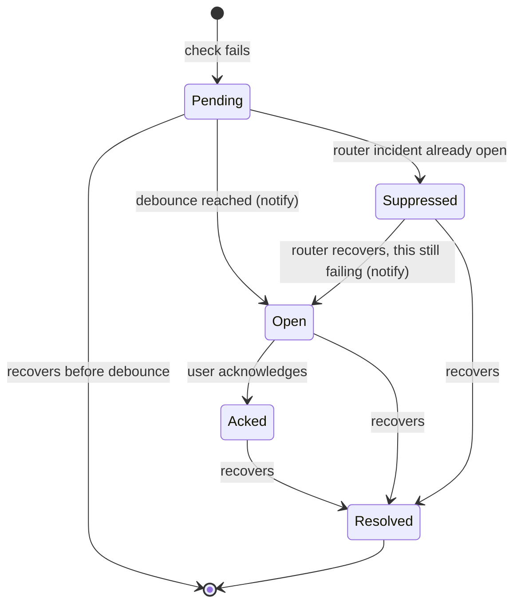

# Net Lantern — Design

**Date:** 2026-10-31
**Status:** Draft for approval (revised 2026-10-31: review fixes; then success criteria, positioning, defaults, journeys, lifecycle, cut line, learning goals, risks)
**Mockups:** https://claude.ai/artifact/GhieYU8sLM7tDeNrKnyi6n (app screens: Dashboard, Devices, Network map, Diagnose, Alerts; landing: "Final mix" boards)

---

## 1. Intent

Net Lantern is a small network operations center for whatever Wi-Fi you are on. You join a network on your laptop, open the dashboard and hit **Scan**. Net Lantern lists every device on the network, identifies what it can, tells you which layer is failing when the internet is slow or down, and keeps watching with alerts.

It is meant to be a **real tool the author uses**, and a **portfolio piece** that shows networking and systems skill (Rust, async I/O, OS networking APIs, a clean web UI). Both matter: it must work reliably on real networks, and the code and presentation must be good enough to show recruiters.

The core idea that separates it from a plain device list: **troubleshooting by layer** — Wi-Fi link → router → internet → DNS → website — with a plain-language verdict and a fix to try.

### 1.1 Positioning
Device scanners and network monitors already exist. Net Lantern doesn't try to beat any one of them at its own job; it joins the pieces a home or small-office user actually needs when "the internet is bad" and answers in plain language.

| Tool | Good at | Where Net Lantern differs |
|---|---|---|
| Fing (desktop/mobile) | Polished device discovery and identification | Local-only, no account; diagnoses *which layer* is failing, not just what's connected; some Fing features need an account or subscription |
| Advanced IP Scanner, Angry IP Scanner | Fast IP and port scanning | Net Lantern adds names that persist, monitoring, history, alerts and diagnosis |
| PingPlotter | Latency and loss over time, hop by hop along the route | Net Lantern has no hop-by-hop route view in v1, but ties latency to a Wi-Fi / router / DNS verdict and to the devices on the network |
| Wi-Fi analyzer apps | Signal and channel congestion | In Net Lantern this is one input to the diagnosis, not the whole product |
| GlassWire | Per-app bandwidth on this PC | Different problem: Net Lantern looks at the network, not apps on the laptop |

**One-line pitch:** *Net Lantern shows what's on your Wi-Fi and, when the internet breaks, which layer broke and what to try — all on your own laptop, no account, nothing uploaded.*

## 2. Goals, non-goals, anti-goals

**Goals (v1)**
- Find and identify every device on the current network from an ordinary laptop connection, no router login.
- Let the user name ("tag") devices once and have names persist; star devices to watch closely.
- Diagnose internet problems layer by layer and say which layer failed and why.
- Show Wi-Fi quality: signal, channel, nearby-network congestion.
- Keep monitoring after the scan, keep history, and alert (dashboard + desktop notification).
- Show a network map that works in a phone browser.
- Ship as something easy to share: a Windows desktop app built from one codebase.

**Non-goals (v1)**
- Router admin integration, SNMP, or per-device agents (no CPU/memory/interface counters of other devices).
- Per-device bandwidth usage.
- Accounts, cloud sync, remote access from outside the network.
- Controlling devices (blocking, kicking, parental controls).
- macOS/Linux builds, native mobile apps (planned after v1).
- Packet capture / intrusion detection. Npcap and raw-frame tools are not used, unless the phase-1 OS-ARP check fails (4.4).
- IPv6 device discovery (IPv4 only in v1).

**Anti-goals (a failure even if it technically works)**
- Uploading any scan data anywhere — including letting another website in the user's browser read it from the local server.
- Needing admin rights for basic use (quick scan, deep scan, diagnosis, monitoring).
- Offensive features: exploitation, credential brute-forcing, deauth, spoofing.
- Scanning a new network deeply without asking the user to confirm they are allowed to.
- Parsing localized text output of OS tools (`netsh`, `arp -a`) — it breaks on non-English Windows.

### 2.1 Success criteria
Initial targets, measured on the author's home network (a /24 Wi-Fi network) unless stated. They are tuned at phase reviews; changes are recorded here. Phase "done when" checks (12) refer to them.

| Area | Target |
|---|---|
| Quick scan time | /24 finished in ≤ 20 s; first devices on screen within 3 s |
| Discovery coverage | ≥ 95% of the devices in the router's client list found by one quick scan |
| Identification | 100% of non-private MACs show a vendor; ≥ 70% of devices get a type other than "unknown" |
| Diagnosis | Correct verdict in 100% of simulated scenarios; on the real network, a wrong DNS server and an unplugged WAN cable each produce the right verdict |
| Alert latency | Starred device offline → alert within 2.5 min (2 min rule + one check interval) |
| False alerts | No alerts from a sleeping phone over a 24 h test; ≤ 1 false alert per day overall |
| Footprint while monitoring | Server process: < 1% average CPU, < 50 MB RAM. Tauri app with window open: < 200 MB RAM |
| Storage | Database < 50 MB after 30 days with 10 starred devices |
| Startup | Dashboard reachable < 2 s after launch |
| Download | Installer < 15 MB |

## 3. Constraints and realities

- **Windows 11 first.** The author's machine; other platforms come later behind the same platform interface.
- **What a Wi-Fi client can see:** IP/MAC/vendor/hostnames/open ports of other devices, plus latency/loss/DNS/HTTP from the laptop's vantage point. Not other devices' internals.
- **Wi-Fi details need location permission.** Recent Windows 11 builds hide SSID/BSSID and nearby-network lists from desktop apps unless location services are allowed. Net Lantern must detect this and guide the user to enable it; everything else keeps working without it.
- **Silent hosts are found with the OS's own ARP, not raw frames.** Devices that ignore ping and TCP still answer ARP. Windows sends ARP requests itself when Net Lantern pings a local address, and `SendARP` / `ResolveIpNetEntry2` resolve an address on demand **without admin** (`SendARP` checked on the author's machine, not elevated, 2026-10-31). This replaces the earlier Npcap + elevated-helper plan; phase 1 confirms it finds ping-silent hosts (see 6.3).
- **Client isolation:** some office/public networks block device-to-device traffic. Net Lantern should say "this network appears to isolate devices" rather than show an empty list silently.
- **Randomized ("private") MAC addresses** on phones: the locally-administered bit is set, vendor lookup fails. Net Lantern marks these as "private address" instead of "unknown vendor".
- **Sleeping phones** stop answering ping for minutes at a time, though many still answer ARP. Presence and alerts must not treat a dozing phone as an outage (6.8, 6.9).
- **Large subnets:** cap the automatic sweep at a /22 (1,022 hosts); for bigger subnets scan the /24 around the laptop and offer to expand.
- **Phones can't do the low-level scan** (iOS/Android block ARP and raw sockets). Phone access in v1 means opening the laptop's dashboard over Wi-Fi.
- **A server on 127.0.0.1 is reachable by every web page the user opens.** Browsers don't apply CORS to WebSockets, and DNS rebinding can defeat same-origin checks on plain HTTP. The local server must authenticate requests even on localhost (6.11).

## 4. Approaches considered

### 4.1 Language and stack
| Option | Trade-off | Decision |
|---|---|---|
| Go | Fast to ship, single binary; weaker desktop/mobile app story | Not chosen |
| **Rust + Tauri v2** | Steeper learning curve; strongest portfolio signal; Tauri v2 builds desktop **and** mobile apps from one codebase; single small binary | **Chosen** (author's priority: profile boost + app compatibility) |
| C#/.NET | Best Windows integration; less portfolio distinction | Not chosen |
| Python | Fastest prototyping; poor packaging/sharing on Windows | Not chosen |

### 4.2 Packaging
| Option | Trade-off | Decision |
|---|---|---|
| **A. Local service + browser dashboard first, Tauri wrapper at end of v1** | Fastest dev/test loop; phone access and a future Raspberry Pi mode come almost free; no "app feel" until the last phase | **Chosen** |
| B. Tauri app from day one (with embedded web server) | App feel early; slower loop, packaging pain from week one, harder automated tests | Not chosen |
| Tauri-only (IPC, no HTTP server) | Breaks phone-browser access and Pi mode | Ruled out |

### 4.3 Build approach (chosen by Claude at the author's request)
| Option | Trade-off | Decision |
|---|---|---|
| **1. Native OS APIs behind a `Platform` trait, built feature-by-feature end to end** | Slightly more upfront learning; fast, no admin, locale-proof; something usable every phase; enables a simulated network for tests/demo | **Chosen** |
| 2. Wrap `ping`/`arp`/`netsh` and parse text, replace later | Quick first demo; breaks on non-English Windows, slow (254 processes), throwaway | Not chosen |
| 3. Whole engine + CLI first, UI last | Solid core; nothing visual for weeks, API/UI mismatch risk, late demo | Not chosen |

### 4.4 Finding hosts that ignore ping and TCP
| Option | Trade-off | Decision |
|---|---|---|
| **OS ARP: ping-triggered ARP + `SendARP`/`ResolveIpNetEntry2`, then read the neighbour table** | No admin, no Npcap, no extra exe; less control over timing and retries | **Chosen**, pending the phase-1 check |
| Raw ARP via Npcap in an elevated helper exe (UAC prompt per scan) | Full control; needs Npcap (can't be bundled), admin, a second exe in a user-writable folder, helper IPC and packaging | Dropped; fallback only if the phase-1 check fails |

## 5. Architecture

```
 Browser (laptop or phone)                    Tauri desktop app (phase 7)
   React dashboard  ◄── REST + WebSocket ──►    webview loads the UI from the
              │                                  same in-process server
 netlantern (one Rust binary)
   ├─ netlantern-server     axum: REST API, WebSocket events, auth (token, Host/Origin
   │                    checks), serves the UI (embedded)
   ├─ netlantern-core       scan pipeline, identification, diagnosis, monitor,
   │                    rules/alerts/incidents, storage (SQLite)
   ├─ netlantern-platform   Platform trait (OS APIs) + NetIo trait (DNS/HTTP/UDP)
   │     ├─ windows     native APIs (ICMP, IP Helper incl. ARP, WLAN)
   │     ├─ net         portable NetIo: DNS, HTTP, mDNS/SSDP/NetBIOS sockets
   │     └─ sim         simulated network from scenario files (tests, --demo);
   │                    implements both traits
   └─ netlantern-cli        dev tool: scan / diagnose / wifi from a terminal
```

**Repository layout (cargo workspace + UI):**
```
netlantern/
  crates/netlantern-core/  crates/netlantern-platform/  crates/netlantern-server/  crates/netlantern-cli/
  ui/                  React + TypeScript dashboard
  apps/desktop/        Tauri v2 app (phase 7)
  site/                static landing page (marketing site, GitHub Pages)
  scenarios/           simulated-network scenario files (YAML/JSON)
  docs/
```

**Runtime model:** one process. Tokio runtime; the scan pipeline, monitor scheduler and alert engine are tasks that publish events on an internal broadcast channel; the WebSocket hub forwards them to connected browsers; storage writes go through one writer task. Every event carries a sequence number so a client can tell when it missed some (8).

**How it runs (v1)** *(Claude's call)*:
- `netlantern-server` is built as a **library** from phase 0, so the same server runs inside two hosts: the standalone `netlantern.exe` (opens the dashboard in the browser; the dev, demo and future Raspberry Pi path, kept as a supported way to run it) and the Tauri app in phase 7, which hosts the server **in its own process**. No second exe is launched.
- **Single instance.** Only one Net Lantern (exe or Tauri app) runs per user. The running instance owns a per-user named pipe (`\\.\pipe\netlantern-<user>`); creating it is the lock. A second launch does not start a server or open the database. It connects to the pipe and sends "open", and the **running instance** issues a fresh one-time token and opens its dashboard (or focuses its window). The second launch can't make a token itself (6.11), so it then exits. This prevents two servers fighting over the port and two writers on one SQLite file.
- The Tauri app keeps running in the **system tray** when its window is closed, so monitoring, history and alerts continue. "Quit" in the tray menu stops it.
- **Start at login** is offered in Settings and is **off by default**.

### 5.1 Platform and NetIo traits (the seam for Windows / simulated / later macOS-Linux-Pi)
Capabilities (names indicative; final signatures are the builder's call).

**`Platform`** — things that need OS APIs:
- `active_interface()` → IPv4 address, prefix, gateway, DNS servers, interface type (Wi-Fi/Ethernet), MAC.
- `ping(ip, timeout)` → RTT + TTL, or timeout (no admin).
- `arp_resolve(ip, timeout)` → MAC or no answer (`SendARP`/`ResolveIpNetEntry2`, no admin).
- `arp_table()` → IP↔MAC entries with state.
- `tcp_probe(ip, port, timeout)` → open/closed/filtered.
- `wifi_current()` → SSID, BSSID, RSSI, channel, band, PHY, link rate — or `PermissionNeeded`.
- `wifi_scan()` → nearby networks (SSID, BSSID, channel, RSSI) — or `PermissionNeeded`. Triggers a radio scan; called on demand only, never by the scheduler (6.7).
- `firewall_status(exe_path)` → allowed / blocked / no rule, per network profile (6.11).

**`NetIo`** — portable network I/O that the simulator must also be able to fake *(decided here, not left to the builder, because phase 0's `--demo` and the DNS / captive-portal scenarios depend on it)*:
- `dns_resolve(server, name)` → addresses or error.
- `http_get(url, follow_redirects)` → status, headers, body prefix, TLS error.
- mDNS browse, SSDP M-SEARCH, NetBIOS node status → announcements collected over a time window.

The real `NetIo` is one portable implementation (tokio sockets, hickory, an HTTP client) shared by every OS; only `Platform` has per-OS code.

**Windows implementation:** `windows` crate — `IcmpSendEcho2`/`Icmp6`… (ICMP without admin), `GetAdaptersAddresses`, `GetIpNetTable2`, `SendARP`/`ResolveIpNetEntry2`, WLAN API (`WlanQueryInterface`, `WlanGetNetworkBssList`), Windows Firewall COM API (`INetFwPolicy2`, read-only) for `firewall_status`.

**Simulated implementation:** loads a scenario (devices, latencies, loss, which layer fails, captive portal, DNS answers, Wi-Fi conditions, events over time such as "printer goes offline at t=60s"). Implements both `Platform` and `NetIo`. Used by integration tests, Playwright e2e, `netlantern --demo` (portfolio demo without a real network), and later the NOC lab mode.

## 6. Features in detail

### 6.1 Network detection and identity
- On start and on network change, read the active interface. Network identity key = **gateway MAC + subnet**; SSID is a display label. All devices, names, history and settings are stored **per network**.
- **Replaced router:** if no network matches the key but a known network has the same SSID and subnet, Net Lantern asks "This looks like *Home* with a new router — keep your devices and names?" Yes updates that network's gateway MAC; no creates a new network.
- First visit to an unknown network: show the network, ask "Is this a network you own or have permission to scan?" before the first deep scan (quick scan allowed without the prompt).

### 6.2 Quick scan (no admin)
1. Sweep the subnet with ICMP echo (concurrency ~64, timeout ~800 ms, 1 retry). Each ping to a local address also makes Windows send an ARP request.
2. In parallel, TCP connect probes on a few common ports (e.g. 80, 443, 445, 22, 62078) to catch hosts that drop ping. *(Changed in phase 1: probes run only against devices already known to be present, because on-link TCP needs an ARP entry first, so probing every address finds nobody new. Only Open ports are kept: Windows reports a refused connect after about 1 s, so at the 800 ms timeout a closed port reads as filtered.)*
3. Read the ARP table: the sweep's pings already made Windows ARP every address, so ping-silent hosts usually have a Reachable/Stale entry. *(Changed in phase 1: Windows also keeps an Unreachable/Incomplete entry, with an all-zero MAC, for every address the sweep pinged. Those count as "has an entry", so ARP resolve runs only for addresses Windows never tried. Before this a real /24 took 31.9 s; after, 7.8 s.)* Call `arp_resolve` (bounded concurrency) **only for addresses with no entry at all**, then read the table again. `SendARP` blocks ~3 s on a silent address, so resolving every non-responder would break the scan-time target (2.1). Hosts that answer only ARP are listed as online with "doesn't answer ping".
4. Listen/query for ~3 s: mDNS service browse, SSDP M-SEARCH, NetBIOS node status, reverse DNS via the gateway. *(Changed in phase 1: mDNS uses one-shot unicast-response ("legacy unicast") queries from an ephemeral port; Net Lantern never binds 5353.)*
5. Identify (6.4) and merge into the per-network device list.
6. Stream progress and each found device over WebSocket (the mockup's progress bar and stage text).

Only one scan runs at a time per network; a second request gets the running scan's id (8).

```mermaid
sequenceDiagram
  participant UI as Browser UI
  participant S as netlantern-server
  participant Scan as scan task
  participant P as Platform / NetIo
  participant DB as storage writer
  UI->>S: POST /api/scans {mode: quick}
  S->>Scan: start (or return the running scan's id)
  S-->>UI: scan_id
  par ICMP sweep
    Scan->>P: ping each host (~64 at a time)
  and TCP probes
    Scan->>P: tcp_probe common ports
  end
  Scan->>P: arp_resolve hosts that answered neither
  Scan->>P: arp_table()
  Scan->>P: mDNS / SSDP / NetBIOS / reverse DNS (~3 s)
  Scan->>Scan: identify (6.4) + merge
  Scan->>DB: upsert devices, MACs, services; finish scans row
  Note over Scan,UI: throughout: scan.progress / scan.device / scan.done<br/>via the event bus and WebSocket
```

### 6.3 Deep scan (opt-in, no admin)
- TCP connect scan of a top-~100 port list on each device, HTTP title/banner grab where open.
- OS guess from TTL (from the ICMP reply) + open-port signature (labelled as a guess).
- No raw ARP and no elevated helper in v1 (4.4). **Phase-1 check:** on the home network, compare devices found by the quick scan against the router's client list. If OS ARP misses devices that a raw ARP sweep would find, the Npcap + elevated-helper design comes back as part of phase 4 and this section is revised. *Note, 2026-11-06, author's laptop on its current Wi-Fi: `--scan-once` found 5 devices in 7.8 s; OS-ARP check against the router's client list still to do.*

### 6.4 Device identification
- **Identity:** a device is its own record, **separate from its MAC addresses** (a device can own several MACs over time). Private (randomized) MACs are flagged *(Claude's call)*. When a new private MAC appears with the same announced hostname or mDNS name as a known device on this network, Net Lantern attaches the MAC to that device: the name is kept and no "new device" alert fires. Otherwise it's a new device. *(Changed in phase 1: identity evidence (mDNS, SSDP, NetBIOS, reverse DNS) is merged across scans with the newest announcement first, so names follow a device's current announcement. A new private MAC is attached to a known device only when exactly one device has that announced name and that device was not already seen in this scan.)* v1 shows no manual merge UI; the schema supports adding one later.
- **Vendor:** embedded IEEE OUI table (refreshed by a build script).
- **Name shown:** user's tag → announced hostname (mDNS, NetBIOS, SSDP friendly name, reverse DNS) → IP address. (Matches the mockup: unnamed devices show their default name or IP.) DHCP hostnames are not available: reading them needs packet capture, a non-goal.
- **Type:** heuristic classifier (router, laptop, phone, tablet, printer, TV, speaker, camera, NAS, console, IoT, unknown) from vendor + mDNS service types + SSDP device type + hostname patterns + open ports, with a confidence value. Pure function, unit-tested.

### 6.5 Tagging and starring
- Rename any device; the name belongs to the **device record** (6.4), so it survives a change of MAC or IP. Clearing the name returns to the default name.
- Star a device to watch it closely: uptime, latency, and optional checks (ping, TCP port open, HTTP 200 on a URL).
- "New device" flag on first sighting; cleared when the user names or acknowledges it.

### 6.6 Diagnosis (layer by layer)
Runs in order and stops at the first **failed** layer (warnings continue):

| # | Layer | Check | Fail / warn |
|---|---|---|---|
| 1 | Wi-Fi link | Connected? RSSI, link rate (Ethernet: link up) | Fail if disconnected; warn below about −70 dBm |
| 2 | Router | 5 pings to the gateway | Fail on 100% loss; warn on >5% loss or high RTT |
| 3 | Internet | Ping 1.1.1.1 and 8.8.8.8, TCP 443 to 1.1.1.1, and a **captive-portal probe**: plain-HTTP GET to a known endpoint (Windows' own `http://www.msftconnecttest.com/connecttest.txt`) without following redirects | **Captive portal** (its own verdict, "sign in to this network") if the probe returns a redirect or unexpected body — checked before deciding the layer failed, because portals usually block ping and outside DNS too; otherwise fail if all checks fail |
| 4 | DNS | Resolve two names via the system DNS servers; also resolve directly via 1.1.1.1 | Fail if system DNS fails but direct works ("DNS server problem"); different verdict if both fail |
| 5 | Website | HTTPS GET to a well-known site | Fail on error; a TLS certificate error gets its own verdict ("something is intercepting secure connections") |

Each layer returns pass/warn/fail/skipped + evidence + a plain-language explanation + "Try this" fix (as in the mockup). The decision logic is a pure function over probe results so it can be unit-tested with every scenario. The README states which outside addresses diagnosis contacts (1.1.1.1, 8.8.8.8, the probe and website URLs); no scan data is sent to them.

Rules settled while building:
- A gateway that answers ARP but not ping warns and continues. (changed in phase 2)
- The portal probe counts 3xx, 511 and any unexpected answer as a portal. (changed in phase 2)
- Blocked ICMP with working TCP or HTTP passes the internet layer. (changed in phase 2)
- The website check treats any HTTP status as reachable and doesn't follow redirects. (changed in phase 2)
- The location permission never fails the link layer. (changed in phase 2)
- Every HTTP check sends the User-Agent `netlantern/<version>`, which carries no personal data. Real testing found www.microsoft.com stalls requests that have no User-Agent; that mechanism is inferred, not proven. (changed in phase 2)

### 6.7 Wi-Fi quality
Current connection (SSID, band, channel, width, RSSI, link rate, security, BSSID) and nearby networks with a channel-congestion chart for 2.4 GHz and 5 GHz, plus one-line advice. Nearby networks are scanned **only on demand** (Diagnose screen open or refreshed), because a radio scan briefly disrupts the connection and would show up as latency spikes in monitoring. If location permission is missing, show what's missing and how to enable it.

Channel overlap and crowding (changed in phase 2):
- Two networks overlap on 2.4 GHz when their channels are less than 5 apart (so 1, 6 and 11 don't overlap). On 5 and 6 GHz they overlap only on the same channel. Channel width is ignored for now.
- A channel is crowded at 5 or more overlapping networks on 2.4 GHz, or 3 or more on the same channel on 5 or 6 GHz.
- If the current-connection channel query fails, the band and channel come from the matched BSS entry first, then from the channel opcode.

### 6.8 Monitoring and history
- Scheduler defaults (configurable): gateway + 1.1.1.1 ping every 30 s; starred devices' checks every 30 s; Wi-Fi metrics every 30 s (current connection only, `wifi_current`, never `wifi_scan`); DNS check every 60 s; light presence refresh (ARP read + ping and ARP resolve of known IPs) every 5 min.
- **Presence:** a device is online if it answers ping **or** ARP. Phones and tablets (by classifier type) get a longer offline grace, default 10 min, because they sleep.
- Storage: raw samples kept 24 h; 5-minute rollups (min/avg/max/loss) kept 30 days; device online/offline transitions kept 90 days. All per network.
- Monitoring runs while Net Lantern runs; it stops when the laptop sleeps or leaves the network. Each stretch of monitoring is recorded as a **monitoring session**, so the history shows "not monitoring" gaps instead of outages.

### 6.9 Alerts and incidents
- Rules (on/off per network, from the mockup):
  - starred device offline (2 min; phones/tablets 10 min, see 6.8);
  - internet down;
  - internet latency high (>100 ms for 2 checks);
  - packet loss on the router or a starred device (≥10% over 15 min, i.e. at least 3 of 30 checks, so a single dropped ping never alerts). Only these are pinged every 30 s, so other devices have no loss data;
  - new device joined;
  - plus "send desktop notifications".
- Debounce (N consecutive failures), auto-resolve on recovery, acknowledge.
- An alert opens an **incident** with a timeline: last good → detected → alerted → affected → (diagnosed) → recovered. "Affected" uses a simple dependency model: devices depend on the router; internet depends on the router. If the router is down, everything is affected: device alerts raised during it are attached to the router's incident as **suppressed** (no notification) instead of opening incidents of their own.
- When the router's incident resolves and a suppressed device alert is still failing, that alert is un-suppressed, opens its own incident and notifies.
- Desktop notifications: Windows toast from the service (e.g. `notify-rust`/WinRT), later via the Tauri notification plugin.

Alert lifecycle ("Pending" lives in memory only; "Suppressed" is the `suppressed` flag on an open alert):



### 6.10 Network map
Router at the center, internet above, devices around it colored by status; click for details; "problems only" filter. Rendered with Cytoscape.js; works on phone widths (labels hide, nodes shrink). Honest note in the UI: switches/mesh points between devices need router access, planned later.

### 6.11 Access and security
The server holds the device list of the user's network, so it is treated as private even on localhost.
- **Bind:** 127.0.0.1 only by default.
- **Host check:** requests whose `Host` header isn't the server's own address (`127.0.0.1:<port>`, `localhost:<port>`, or the LAN address while phone access is on) are refused. This blocks DNS rebinding.
- **Origin check:** requests and **WebSocket upgrades** that carry an `Origin` other than the server's own are refused. This stops other web pages from reading the event stream or calling the API.
- **Token on localhost too:** `netlantern.exe` opens the browser at a URL with a one-time token; the Tauri webview loads the UI from the same server with a token. The token is exchanged for a session cookie (`HttpOnly`, `SameSite=Strict`); requests without a valid session are refused.
- **Phone access:** Settings → "Allow phone access" binds to the LAN, generates a random access token, and shows a QR code with the URL + token, exchanged for a session cookie the same way. Turning it off rotates the token and ends every phone session.
- Plain HTTP on the LAN in v1 (the token is the protection); HTTPS on LAN is a later improvement.
- **Windows Firewall** *(Claude's call)*: phone access is an optional feature, not basic use, so a **one-time admin step is acceptable**. Turning it on the first time triggers the Windows Firewall prompt, and Net Lantern explains the prompt beforehand. If the prompt is dismissed, Windows silently adds a blocking rule and never asks again; Net Lantern reads the rules (`firewall_status`) after enabling and, if blocked, explains how to allow it. The exe and the Tauri app are different programs to the firewall, so each gets its own rule. On networks Windows marks **Public**, phone access stays off; Net Lantern says why and how to mark the network Private. The installer stays **per-user** (no admin needed to install).

### 6.12 Defaults
Every tunable value in one place. The builder implements them as one config struct; user-facing ones appear in Settings. If a number elsewhere in this document disagrees, this table wins. Changes made while tuning on real networks are recorded here.

| Group | Setting | Default |
|---|---|---|
| Quick scan | ICMP concurrency / timeout / retries | 64 / 800 ms / 1 |
| | TCP probe ports | 80, 443, 445, 22, 62078 |
| | ARP resolve concurrency | 32 |
| | Discovery listen window (mDNS, SSDP, NetBIOS) | 3 s |
| | Largest automatic sweep | /22 (else the /24 around the laptop) |
| | TCP probe timeout / concurrency *(changed in phase 1)* | 800 ms / 64 |
| | ARP resolve timeout *(changed in phase 1)* | 3 s |
| | ARP poll interval during the sweep *(changed in phase 1)* | 1 s |
| | NetBIOS timeout *(changed in phase 1)* | 1 s |
| | DNS query timeout *(changed in phase 1)* | 1 s |
| | UPnP description timeout *(changed in phase 1)* | 2 s |
| Deep scan | Port list | top ~100 TCP ports (list chosen by the builder) |
| Diagnosis | Gateway pings | 5, timeout 1 s each *(timeout changed in phase 2)* |
| | Wi-Fi warn below | −70 dBm |
| | Router warn | any loss of the 5 pings (> 5%), or average RTT > 50 ms *(50 ms changed in phase 2)* |
| | ARP fallback when the gateway answers no ping *(changed in phase 2)* | `arp_resolve`, timeout 3 s |
| | Internet targets | ICMP 1.1.1.1 and 8.8.8.8; TCP 443 to 1.1.1.1 |
| | Internet pings *(changed in phase 2)* | 3 per target, timeout 1 s |
| | TCP 443 to 1.1.1.1 *(changed in phase 2)* | timeout 2 s |
| | Internet warn latency *(changed in phase 2)* | average > 100 ms (the same number as the §6.9 alert) |
| | Captive-portal probe | `http://www.msftconnecttest.com/connecttest.txt` |
| | Captive-portal expected body *(changed in phase 2)* | `Microsoft Connect Test` |
| | Direct DNS server | 1.1.1.1 |
| | DNS test names *(changed in phase 2)* | `www.microsoft.com`, `www.cloudflare.com` |
| | Website URL *(changed in phase 2)* | `https://www.microsoft.com/` |
| | Per-layer time limit *(changed in phase 2)* | 15 s |
| | Nearby scan wait after `WlanScan` *(changed in phase 2)* | 4 s |
| | Reuse a nearby scan *(changed in phase 2)* | 10 s for `POST /api/wifi/scan`, 60 s for a diagnosis |
| | Settle after a diagnosis-triggered radio scan *(changed in phase 2)* | 2 s (new) |
| | Crowded channel *(changed in phase 2)* | ≥ 5 overlapping networks on 2.4 GHz; ≥ 3 on the same channel on 5 or 6 GHz |
| | Signal labels *(changed in phase 2)* | ≥ −50 Excellent, ≥ −60 Good, ≥ −70 Fair, else Weak |
| Monitoring | Gateway + 1.1.1.1 ping | every 30 s |
| | Starred-device checks | every 30 s |
| | Wi-Fi metrics (`wifi_current`) | every 30 s |
| | DNS check | every 60 s |
| | Presence refresh | every 5 min |
| | Offline grace, phones/tablets | 10 min |
| Alerts | Debounce | 2 consecutive failures unless the rule says otherwise |
| | Starred device offline | 2 min (phones/tablets 10 min) |
| | Internet latency high | > 100 ms for 2 checks |
| | Packet loss on a device | ≥ 10% over 15 min (≥ 3 of 30 checks) |
| Retention | Raw samples / 5-min rollups / presence transitions / logs | 24 h / 30 days / 90 days / 7 days |
| Server | Bind address | 127.0.0.1 (LAN only with phone access on) |

## 7. Data model (SQLite, one file under `%LOCALAPPDATA%\NetLantern`)
- `networks` (id, gateway_mac, subnet, ssid_label, first_seen, last_seen, scan_consent)
- `devices` (id, network_id, last_ip, hostname, vendor, type, type_confidence, name, starred, is_new, first_seen, last_seen)
- `device_macs` (device_id, mac, private_mac, first_seen, last_seen) — a device can own several MACs
- `device_services` (device_id, source: mdns/ssdp/netbios/dns, value)
- `device_ports` (device_id, port, proto, service, banner, seen_at)
- `presence` (device_id, ts, online)
- `scans` (id, network_id, mode: quick/deep, state: running/done/cancelled/failed, started_at, finished_at, devices_found)
- `monitor_sessions` (id, network_id, started_at, ended_at, end_reason: sleep/network_left/quit/crash)
- `samples` (network_id, target, metric, ts, value) and `samples_rollup` (network_id, target, metric, bucket_start, min, avg, max, loss)
- `checks` (device_id, kind, params, enabled)
- `incidents` (id, network_id, root_alert_id, opened_at, resolved_at)
- `alerts` (id, network_id, incident_id, rule, severity, subject, suppressed, state: open/acked/resolved, opened_at, acked_at, resolved_at)
- `incident_events` (incident_id, alert_id, ts, kind, text)
- `settings` (scope, key, value)
Migrations are versioned and run on start.

## 8. API (REST + one WebSocket)
All endpoints require a session (6.11).
- `POST /api/session {token}` → session cookie
- `GET /api/network` — current network + interface info
- `POST /api/scans {mode: quick|deep}` → scan id; if a scan is already running, `409 scan_in_progress` with its id. Events `scan.progress`, `scan.device`, `scan.done`
- `GET /api/scans/:id` — state, progress and devices found so far (to catch up after a reconnect); `POST /api/scans/:id/cancel`
- `GET /api/devices?filter=…`, `GET /api/devices/:id`, `PATCH /api/devices/:id {name, starred, checks}`
- `POST /api/diagnose` → run id; events `diagnose.step`, `diagnose.done`; `GET /api/diagnose/:id` — steps so far
- `GET /api/wifi`, `POST /api/wifi/scan` (nearby networks, on demand)
- `GET /api/metrics?target=&metric=&range=`
- `GET /api/alerts?state=`, `POST /api/alerts/:id/ack`
- `GET /api/incidents/:id` — incident with timeline and suppressed alerts
- `GET/PUT /api/rules`, `GET/PUT /api/settings`
- `POST /api/phone-access {enabled}` → URL + QR payload, or `public_network` / `firewall_blocked`
- `GET /api/events` (WebSocket) — all live events: scan, diagnose, sample, device state, alert. Each event has a sequence number. On connect or reconnect the client loads current state over REST, then applies events; if it sees a gap in sequence numbers it reloads. (Phone browsers drop the socket whenever they go to the background.)

Errors are structured (`code`, `message`, `hint`), e.g. `location_permission`, `scan_in_progress`, `firewall_blocked`, `public_network`, `unauthorized`.

**Versioning:** every REST response carries an `api_version` header and every WebSocket event an `api_version` field; a breaking change bumps it. The bundled UI always matches its own server, so this matters for other clients — the future Raspberry Pi mode and anything that scripts against the API. A client that sees an unexpected major version shows "This dashboard is out of date — reload".

## 9. UI
- **Stack:** React + TypeScript + Vite, Tailwind CSS, TanStack Query (server state) + Zustand (live/WebSocket state), uPlot (time series), Cytoscape.js (map). Built into the Rust binary (embedded static files).
- **Screens** (as mocked): Dashboard (scan buttons + progress, KPI tiles, latency graph with **two series, router and internet**, so journey A can tell a local problem from a provider problem, path to internet, starred devices, recent alerts), Devices (search, filters, rename, star, details panel), Network map, Diagnose (layer trace + Wi-Fi quality + nearby networks), Alerts & incidents (list, timeline, acknowledge, rules, notification preview).
- **Added beyond the mockups:** Settings (scan schedule, retention, notifications, phone access, update check, copy debug info, data reset) and a first-run screen ("Network detected — run your first scan", permission/consent prompts, "looks like a known network" prompt).
- **Look:** dark NOC style from the mockups; colors defined as design tokens (CSS variables) so the palette can be swapped without touching components. Responsive down to phone width; touch targets ≥44 px; status always shown with text, not color alone.
- **Landing page** is a separate static marketing site in `site/` (not part of the app), deployed to GitHub Pages, following the "Final mix" mockup (centered hero with 3D globe, Without vs With, bento features, scan story, live demo, diagnosis trace, who it's for, FAQ, download).

### 9.1 User journeys
Three end-to-end stories that check the screens fit together. Each also becomes a Playwright test against a matching simulated scenario and a demo script for the README and landing page.

**A. "My video calls keep freezing."**
1. The user opens the dashboard (on the laptop, or on their phone via phone access).
2. The latency graph shows spikes to **both** the router and 1.1.1.1, so the problem is between the laptop and the router, not the provider.
3. Diagnose: layer 1 warns (−74 dBm; 2.4 GHz channel 6 shared with 9 networks); layers 2–5 pass.
4. Verdict: "Your Wi-Fi signal is weak and the channel is crowded." Try this: move closer to the router, or join the 5 GHz network shown in the nearby list.
5. If the latency rule fired, the Alerts screen shows the incident with its timeline.

**B. "A new device joined at 2 a.m."**
1. The "new device joined" rule fires; a toast reads "New device: 192.168.1.57 — Espressif, IoT".
2. Devices → details: vendor, open ports, mDNS name, first seen.
3. The user recognises their smart plug and renames it "Desk plug"; the new-device flag clears.
4. If they don't recognise it, the panel explains what Net Lantern can't do (block devices is a non-goal) and what to try: check the router's client list, change the Wi-Fi password.

**C. "First run on a café network."**
1. The first-run screen shows the network (SSID, marked Public by Windows) and offers a quick scan; deep scan asks for permission first.
2. The quick scan finds only the gateway → "This network appears to isolate devices."
3. The user hasn't signed in to the café's portal yet: Diagnose stops at layer 3 with "Sign in to this network" instead of "Internet down".
4. Settings → phone access is unavailable, with the reason (Public network) shown.

## 10. Errors, permissions, edge cases
- No location permission / firewall blocked / Public network → feature-level degraded state with an explanation and the one action that fixes it; never a hard failure of the whole scan.
- Network change mid-scan → scan cancels cleanly, UI shows the new network.
- No network → dashboard shows "Not connected" and the diagnosis stops at layer 1.
- Client isolation detected (only the gateway answers ping and ARP) → explicit message.
- Laptop sleep → the monitoring session ends; the gap shows as "not monitoring", not as an outage.
- Second launch while Net Lantern is running → opens the running instance and exits (5).
- Request from another origin or with a foreign `Host` → refused, logged once.

### 10.1 Updates, uninstall, logs
- **Update check:** the first-run screen asks whether Net Lantern may check GitHub Releases for new versions (no default pre-selected; changeable in Settings). The check is one request for the latest version number; it sends no scan data. A newer version shows a banner linking to the release page. No automatic download or install in v1.
- **Upgrades and migrations:** before running migrations on a new version, Net Lantern copies the database file (keeps the last copy). A database written by a *newer* Net Lantern is not opened; Net Lantern says so instead of risking damage.
- **Uninstall:** the per-user uninstaller removes the app and asks whether to also delete Net Lantern's data in `%LOCALAPPDATA%\NetLantern`. Firewall rules created by the Windows prompt need admin to remove, so the uninstaller says how to remove them instead of failing silently. Settings → data reset clears data without uninstalling.
- **Logs:** structured logs (`tracing`) to rotating files in `%LOCALAPPDATA%\NetLantern\logs`, kept 7 days. Session tokens are never logged.
- **Crashes:** a panic hook writes the panic to the log; the monitoring session ends with reason `crash`.
- **Copy debug info:** Settings button that copies Net Lantern version, Windows build, interface type, permission/firewall states, recent errors and the last log lines to the clipboard, with IPs, MACs, SSIDs and device names redacted. Nothing is sent anywhere; the user pastes it into a bug report.
- **API version:** see 8.

## 11. Testing and quality
- **Unit tests:** identification/classification, diagnosis decision logic (including captive portal with ping blocked, and TLS interception), alert rules/debounce/incident building/suppression, rollup maths, OUI lookup.
- **Integration tests** against the simulated platform using scenario files: healthy, weak Wi-Fi, DNS failure, provider down, captive portal (ping and outside DNS blocked), printer offline at t+60 s, new device joins, client isolation, ARP-only host, sleeping phone (no ping, answers ARP), router replaced (same SSID and subnet, new gateway MAC), router down with device alerts suppressed.
- **API tests** (axum test client) and **WebSocket event** tests, including sequence gaps and reconnect catch-up.
- **Security tests:** requests and WebSocket upgrades with a foreign `Origin`, a rebinding-style `Host`, or no session are refused; turning phone access off ends phone sessions.
- **UI:** Vitest for components; Playwright end-to-end against `netlantern --demo`, including one test per user journey (9.1).
- **Targets:** the measurable success criteria (2.1) are checked at each phase review; scan time and footprint are logged so regressions show up.
- **CI:** GitHub Actions on a Windows runner: `cargo fmt --check`, `clippy -D warnings`, `cargo test`, UI lint + tests, Playwright, release build.
- Manual test checklist on a real home network for each phase.

## 12. Delivery phases (v1)
Each phase ends with something runnable.

| Phase | Delivers | Done when |
|---|---|---|
| 0 Foundations | Workspace, Platform + NetIo traits, simulated platform + scenarios, axum server + WebSocket with sequence numbers, session token + Host/Origin checks, single-instance lock, UI shell with routing and tokens, CI | `netlantern --demo` serves the dashboard with simulated devices; a page on another origin can't open the WebSocket |
| 1 Quick scan + devices | Windows platform (interface, ping, ARP resolve, ARP table, TCP probe), mDNS/SSDP/NetBIOS/rDNS, OUI, classifier, Devices screen with rename/star; **OS-ARP check** against the router's client list (6.3) | A real scan on the home network lists devices with vendors; names persist; OS-ARP result recorded; scan-time, coverage and identification targets met (2.1) |
| 2 Diagnosis + Wi-Fi | Layer checks incl. captive-portal probe, verdicts/fixes, Wi-Fi current + on-demand nearby scan + congestion, location-permission flow | Diagnose screen gives correct verdicts on the real network and every simulated scenario (2.1); journey C's portal step works in the simulator |
| 3 Monitor + alerts | Spikes first: toast from an unpackaged exe, and a minimal Tauri app hosting the server library (16). Then scheduler, monitoring sessions, samples/rollups, presence (ping or ARP, sleep grace), starred checks, rules, incidents with suppression, desktop notifications, Dashboard + Alerts screens | Unplugging the printer produces an alert, a toast and a timeline that resolves when it returns; a sleeping phone doesn't alert; alert-latency, false-alert, footprint and storage targets met (2.1) |
| 4 Deep scan | Port scan, banners, OS guess, consent prompt, degraded states (plus the raw-ARP helper only if the phase-1 check failed) | Deep scan works without admin |
| 5 Network map | Map screen, filters, phone layout | Map usable on desktop and phone width |
| 6 Phone access + settings | LAN toggle, token + QR, firewall detection, Settings screen, first-run flow (incl. known-network prompt), responsive polish | Phone opens the dashboard via QR; refused without token; dismissed firewall prompt is detected and explained |
| 7 Ship | Tauri v2 desktop app hosting the server (tray, keep-running, start-at-login option, notifications), per-user installer with data-removal choice, update check, logs + copy debug info, **unsigned** GitHub release with SmartScreen guidance in README and on the download page, README + screenshots, landing site | A stranger can download, install and scan; journeys A–C pass end to end; startup and download-size targets met (2.1) |

**Cut line** *(Claude's call)*: the smallest v1 worth releasing is **phases 0–3 plus a slim phase 7** (Tauri app, installer, release, README; landing site optional). If the work drags, these slip to v1.1 in this order, first to last: landing site (README and screenshots stand in), network map, phone access, deep scan. Deep scan goes last because without admin it mostly reuses the quick scan's TCP probe. Slipping a phase never breaks the ones before it, because each phase ends runnable.

**After v1 (in order of likely value):** Raspberry Pi / 24/7 headless mode; macOS + Linux; NOC lab mode on the simulated platform (router-goes-down drills: detect → alert → affected → incident → recovery); SNMP for routers/servers; multi-network history UI; phone push alerts (ntfy/Telegram); IPv6 discovery; native mobile app via Tauri v2 with lighter scanning.

## 13. Who builds it, and how

- **Claude writes the code from the implementation plan; the author reviews**, runs it and learns from it. The plan is therefore written for an agent: precise tasks with file paths, tests written before each piece of code, and small commits.
- **A review checkpoint ends every phase:** a runnable demo, a short summary of what was built and why, the manual test checklist for the author to run on the real network, and a **learning check**: Claude asks the author to explain two or three of the phase's learning goals (below) in their own words. Any gap gets a short code walkthrough before the next phase starts. The point: recruiters will ask the author, not Claude, how this works.
- **One plan per phase.** Each phase gets its own implementation plan, written at the previous phase's review so it reflects what was learned.
- **No target date.** Phases are sized to be reviewable on their own.
- **Release builds are unsigned for v1.** Signing can be added later if people start using it.

**Learning goals per phase** (what the author should be able to explain afterwards):

| Phase | Learning goals |
|---|---|
| 0 | Cargo workspaces; traits as a seam for real vs simulated code; tokio tasks and broadcast channels; axum routing and WebSockets; why a localhost server needs a token and Host/Origin checks (DNS rebinding, cross-site WebSocket hijacking); embedding static files in a binary |
| 1 | How ICMP works without raw sockets (`IcmpSendEcho2`); ARP and the neighbour cache; mDNS, SSDP and NetBIOS in one paragraph each; OUI lookup and the locally-administered MAC bit; how the classifier scores a device; calling Win32 safely through the `windows` crate |
| 2 | What failure looks like at each layer and why the order matters; how captive portals work; the DNS resolution path; the WLAN API and Windows' location rule; RSSI, channels, channel width and congestion |
| 3 | Scheduling and debouncing; rollups and retention; one SQLite writer task and versioned migrations; the incident dependency model and suppression |
| 4 | TCP connect scan vs SYN scan and why Net Lantern uses connect; banner grabbing and the consent prompt; how far a TTL-based OS guess can be trusted |
| 5 | Graph layout with Cytoscape.js; responsive rendering for phone widths |
| 6 | Session tokens and cookie flags; what exposing a server on the LAN changes; Windows Firewall profiles and rules |
| 7 | How Tauri hosts the server in-process; tray lifecycle; per-user installers; SmartScreen and code signing |

## 14. Decided vs deferred

**Decided:** everything above.

**Calls Claude made** (flagged for the author's review): build approach 1 (native APIs, feature-by-feature); server as a library hosted in-process by both the exe and Tauri, one instance per user; tray keep-running with start-at-login off by default; OS ARP instead of Npcap + an elevated helper, so v1 needs no admin except the firewall prompt (pending the phase-1 check); a NetIo trait so the simulator fakes DNS/HTTP/mDNS; session token plus Host/Origin checks on localhost as well as the LAN; captive-portal probe inside the internet layer; sleep grace for phones and a 3-of-30 loss threshold; the starting success targets (2.1) and defaults (6.12); an opt-in update check that only notifies; the cut line and slip order (12); a learning check at each phase review (13); a one-time firewall prompt for phone access, with phone access off on Public networks; device identity separate from MAC, with automatic merge by announced name; a per-user installer.

**Deferred (author will choose later; doesn't block phases 0–6):**
- Palette: **cyan** vs **green-and-red** (implemented as tokens, so it's a swap).
- Landing background animation, shortlist: **Packet routing**, **Live log**, Circuit traces, Network, Data rain.

## 15. Left to the builder
Exact crate choices and versions within the stated stack, internal module layout, default port number, tuning the values in the defaults table (6.12) on real networks and recording changes there, the port list for deep scan, OUI refresh mechanism, icon set, exact WebSocket event payloads, migration tooling, the fallback when a gateway ignores ping, choosing the interface when a VPN is active, and toast registration for an unpackaged exe.

*(Changed in phase 1)* Decisions made for two of these:
- **Interface with a VPN active:** prefer a physical Wi-Fi or Ethernet adapter that has a gateway, then the lowest metric, then the lowest interface index. APIPA (169.254.x.x) addresses are ignored.
- **Gateway ignores ping:** the network is identified by the gateway's ARP reply. If there is none, the scan fails with "Your router at {gateway} didn't answer, so this network can't be identified."

(Changed in phase 2) Decisions made for two more:
- **Gateway ignores ping, for diagnosis:** the router layer falls back to an ARP resolve (timeout 3 s). A gateway that answers ARP but not ping warns and diagnosis continues.
- **Redirects:** HTTP checks follow redirects only on the same host, up to 5; a redirect to another host is not followed (diagnosis itself never follows them).

## 16. Risk register
The known unknowns in one place. Each is checked as early as possible; the fallback keeps the project moving if it goes badly.

| Risk | Impact | How we find out | Fallback |
|---|---|---|---|
| OS ARP misses devices that ignore ping and TCP | Incomplete device list | Phase-1 check against the router's client list (6.3) | Npcap + elevated helper returns in phase 4 |
| Windows' location rule blocks Wi-Fi details for an unpackaged exe even with location on | No SSID, BSSID or nearby networks | Phase 2 on the author's machine | Guidance screen; everything else works; retest once the Tauri app has a package identity |
| Toasts from an unpackaged exe need an app ID and Start Menu shortcut | No desktop alerts before phase 7 | Short spike at the start of phase 3 | Dashboard alerts only until the Tauri notification plugin |
| Tauri hosting the axum server in-process (tray, lifecycle, ports) is harder than expected | Phase 7 slips | Minimal Tauri app that starts the server library, built as a spike during phase 3 | Ship `netlantern.exe` as the release; Tauri in v1.1 |
| Windows throttles 64 concurrent pings or ARP requests | Slow or missed scans | Phase-1 timing against 2.1 | Lower concurrency; longer sweep |
| Outside endpoints (1.1.1.1, 8.8.8.8, the portal probe URL) blocked on some networks | Wrong diagnosis verdicts | Simulated scenarios + testing on an office network | Endpoints configurable (6.12); already two internet targets plus TCP |
| SmartScreen warns on the unsigned installer | Strangers give up installing | Feedback on the first release | Clear guidance (12); sign later |
| Scope outgrows the author's time | Project stalls | Phase reviews | Cut line (12) |
| Author can't explain the code in interviews | Portfolio value drops | Learning check each phase (13) | Walkthroughs before moving on |

Location-rule row, phase 2 first data point: details were returned in one tested state; full matrix at the phase review.
